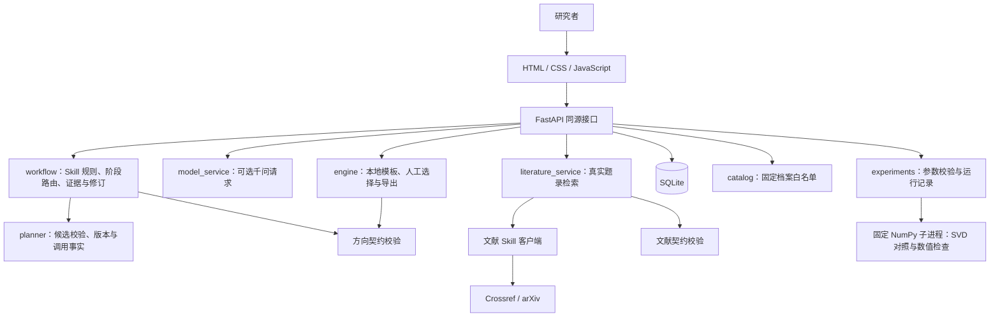

# 研证 · Yanzheng Research Workbench


**从初始想法走向有依据、能验证、可追溯的首轮研究。**

研证面向数理与 AI 研究起步，帮助研究者梳理问题与资源、查询文献、记录阅读依据、比较与修订候选课题，并形成包含基线、指标和停止条件的首轮计划。随机低秩逼近场景可进一步运行固定的随机 SVD 对照实验；其他方向先完成文献与计划流程。

当前应用版本为 **0.4.0**，仓库整理日期为 **2026-10-16**。主程序位于 `webapp/`：FastAPI 同源服务、无构建前端、SQLite、百炼千问适配器与固定数值实验进程。它是本地单人工作台，尚未按多用户公网服务设计。

## 使用路径

```text
输入 idea 与约束 → 千问判断信息是否足够 → 少量澄清 / 直接返回候选
       ↓                                ↓
真实查询文献 → 确认阅读位置与摘录 → 根据证据修订候选
                                          ↓
                              研究者选择并说明理由
                                          ↓
                    导出首轮计划 / 运行固定 SVD 实验
                                          ↓
                           依据实际结果重开比较与修订
```

网站提供方向探索、文献工作台、实验工作台、案例与证据、研究项目、研究记录和项目说明。推荐与人工选择分开，查询结果与实际阅读分开，历史实验与本次新运行分开。

## 已实现的能力

| 模块 | 当前状态与边界 |
|---|---|
| Skill 科研流程 | 请求时读取两个 Skill 的实际规则，保存版本哈希；信息不足返回 1–3 个澄清问题，足够时直接给候选 |
| 研究简报与补充资料 | 保存目标、资源、时间、澄清回答及补充文本；请求失败保留输入和已有候选，允许手动重试 |
| 本地候选 | 无 Key 时可用；按明确标记的模板组织，不能当作已完成的文献查新 |
| 千问规划与修订 | 显式发起后依照简报、真实查询、已确认的阅读摘录及此前实验摘要返回统一 JSON；校验结果、保留旧版本与调用事实 |
| 网页文献检索 | Crossref / arXiv，每轮 1–5 条；真实请求，保存成功、无结果和失败，单轮独立导出 |
| 阅读证据 | 用户确认读过摘要或相关正文，保存内容、位置和时间；以检索轮次与来源组成稳定引用，不把 API 摘要自动视为已读 |
| 研究项目与导出 | SQLite 真实持久化、重启恢复、历史、选择理由、项目 JSON 和计划 Markdown 下载 |
| 案例与证据 | 五个案例架构、四篇历史阅读来源、随机 SVD 历史实验及白名单 JSON 下载 |
| 方向探索 Skill | 澄清、文献对照、候选比较、验证计划与研究者选择的工作规则及校验器 |
| 文献检索 Skill | CLI 支持 Crossref / arXiv / OpenAlex、JSON/RIS 导入、标识符去重、版本与来源记录、方向来源适配 |
| 固定随机 SVD 实验 | 人工选题后运行固定算法，记录矩阵哈希、种子、精确基线、逐次结果、数值检查和限制，导出 JSON / CSV |
| 通用实验与独立证明 | 尚未实现；不执行任意代码，不把数值检查等同于一般数学证明 |

千问曾完成真实账号接入验收；这不意味着新安装者的配置已连通。模型现在可使用程序提供的检索状态、稳定来源 ID 和用户确认的阅读摘录修订候选。题录级来源只作为检索线索；科学论断的支持仍限于实际确认过的阅读范围，须由研究者审查。

## 架构



网络请求与实验计算均在 SQLite 写事务之外执行。模型只能提议受约束的阶段、问题、候选与证据关联；人工选择、阅读确认、实际请求和执行状态由程序记录。采用确定的状态节点与既有 FastAPI / SQLite，未引入 LangGraph 依赖，也没有运行自主多智能体研究团队。

### 主要组件

| 文件 | 职责 |
|---|---|
| [`webapp/app.py`](webapp/app.py) | API、输入检查、静态页面、状态和下载 |
| [`webapp/engine.py`](webapp/engine.py) | 本地候选、澄清、选题、计划与事实驱动导出 |
| [`webapp/planner.py`](webapp/planner.py) | 模型候选合同、旧版本、输入版本与并发保护 |
| [`webapp/workflow.py`](webapp/workflow.py) | 运行时读取 Skill、澄清路由、检索来源适配、阅读证据与候选修订 |
| [`webapp/model_service.py`](webapp/model_service.py) | 本机模型配置、官方端点约束、HTTP、用量与脱敏错误 |
| [`webapp/literature_service.py`](webapp/literature_service.py) | 文献客户端适配、有限查询和应用级 arXiv 间隔 |
| [`webapp/storage.py`](webapp/storage.py) | SQLite 持久化与原子修改 |
| [`webapp/catalog.py`](webapp/catalog.py) | 历史资料与固定下载清单 |
| [`webapp/experiments.py`](webapp/experiments.py) | 固定实验的可用性、参数、独立子进程、失败保存和 CSV |
| [`webapp/experiment_worker.py`](webapp/experiment_worker.py) | 三类合成矩阵、精确 / 随机 SVD、实际误差与计时、有限数值检查 |
| [`webapp/static/`](webapp/static/) | 原生前端、内容转义和预设科研伙伴交互 |

### 数据与证据合同

- `research_direction_map` v1：输入、背景、问题、来源、候选、推荐、用户选择与下一步。
- `research_literature_search` v1：实际查询、结果、失败、来源、版本、阅读等级和证据位置。
- `research_experiment_run` v1：启动时选题快照与哈希、参数、独立执行事实、逐次结果与限制。
- 项目记录：方向地图、检索轮次、用户确认的阅读摘录、待处理输入、动作历史、候选版本、模型调用与实际 Token 用量。

来源等级为 `unverified → metadata_checked → abstract_checked → fulltext_checked`。接口返回摘要或 PDF 链接不会自动升级阅读等级；JSON 校验通过也不能证明科学结论正确。`fulltext_checked` 表示读过相关正文，须保留版本和具体位置，不表示通读全文。

原始文献来源 ID 仅在每轮内唯一。科研流程将 `run_id + source_id` 组成跨轮稳定引用，保留来源来路与阅读位置；用户阅读确认是单独的追加记录，不覆盖原始题录。早期 Skill 已有的阅读材料仍属于历史档案。

阅读记录由用户确认，当前没有独立的论文版本指纹，候选也未精确绑定到单条阅读笔记；程序不会核定论断是否得到正文支持。模型修订通过校验后直接应用并保存旧版本，应用前的差异预览尚待实现。旧 `/generate` 接口只使用研究简报；新版完整证据上下文由 `/advance` 流程提供。

## 快速开始

完整应用需要 **Python 3.12+**（固定的 NumPy 2.5.4 要求）；网站无需 GPU 或 Node 构建环境。

```shell
git clone https://github.com/mingxuanyan07-lgtm/yanzheng-research-workbench.git
cd yanzheng-research-workbench
```

### Windows / PowerShell

```powershell
cd webapp
.\Setup-Workbench.ps1
.\Start-Workbench.ps1
```

也可在已准备环境后双击根目录 `启动研证网站.cmd`。若系统限制脚本执行，可按下面的标准 Python 方式准备和启动，无需修改系统执行策略。

### 标准 Python 方式

```shell
cd webapp
python -m venv .venv
```

Windows 激活：`.\.venv\Scripts\Activate.ps1`；macOS/Linux 激活：`source .venv/bin/activate`。也可直接使用虚拟环境内 Python 的完整路径。

```shell
python -m pip install -r requirements.txt
python -m uvicorn app:app --host 127.0.0.1 --port 8097
```

浏览器访问 <http://127.0.0.1:8097/>；API 文档位于 <http://127.0.0.1:8097/api/docs>。按 Ctrl+C 停止。首次运行自动创建本机 `webapp/data/research.db`；仓库不携带任何人的真实项目数据库。

### 可选配置 Qwen

默认本地模板模式不需要模型 Key。Windows 在 `webapp/` 运行：

```powershell
.\Configure-Qwen.ps1
```

脚本通过隐藏输入保存本机 Key 与控制台的兼容 Base URL。其他系统可参考 [`.env.example`](webapp/.env.example) 在本机配置；接入地址、Key 和地域必须匹配，不要照抄文档占位符。配置文件不进入版本库。

刷新网页状态后，明确选择 Skill 科研流程并提交，或在已有项目点击千问操作，才会发起模型请求。模型可决定先澄清或直接给候选；补充回答、资料或要求修订同样会发起一次调用。默认 `qwen-plus`，120 秒超时、最多 3500 输出 Token，一次操作一次请求，不自动重试、不自动执行建议检索。用量来自接口，不推算货币费用。配置存在、最近调用成功、本项目实际使用模型分别记录。

## 独立使用 Skill

两个目录均有 `SKILL.md`、界面元数据及所需参考/脚本，可以在支持 Skill 的工具中使用，也可直接运行文献客户端。

```text
使用 $research-direction-guide，结合我的目标与资源，整理可验证的候选课题。
使用 $literature-search，检索相关方法与局限，说明实际阅读范围并保存证据记录。
```

在仓库根目录运行，无额外 Python 依赖：

```shell
python skills/literature-search/scripts/search_literature.py --query "randomized low rank approximation" --providers crossref,arxiv --limit 5 --output tmp/literature.json
python skills/literature-search/scripts/validate_literature_record.py tmp/literature.json
```

OpenAlex 和 RIS/JSON 导入目前属于 Skill/CLI 能力，网页尚未提供相应按钮。学校订阅访问不等于公开产品的数据库 API 权限；本仓库不代理复旦账号或订阅全文。详细来源与机构资源边界见 [providers.md](skills/literature-search/references/providers.md)。

## 测试与验证

在仓库根目录、已安装网站依赖的 Python 环境中运行：

```shell
python -B scripts/run_tests.py
python -B scripts/run_tests.py --suite web
python -B scripts/run_tests.py --suite skills
```

入口在导入应用前设置临时数据库，避免默认 `Store` 初始化触碰本机研究库。测试使用模拟模型/网络，不调用真实千问，也不要求提供 Key；固定实验测试会实际执行小规模 NumPy 数值计算。本次发布的快照测试记录见 [验证报告](docs/validation-2026-10-16.json)。GitHub Actions 配置执行同样的离线检查；持续集成状态以实际运行记录为准。

历史验证与当前测试分开：文献客户端曾真实查询三个公开接口，每个返回两条；独立试跑保留四篇阅读交接，其中三篇读过相关正文、一篇读过摘要。Qwen 曾生成并保存三条候选、保留旧方向版本，记录 3035 Token。真实模型调用通过不等于候选的科学判断已经核实。个人项目导出和本机调用截图不纳入此仓库。

## 历史实验与仓库范围

网站运行所需的五份归档 JSON 保留在原路径，不能只复制 `webapp/`：

```text
output/math-ai-workbench/experiment-data.json
output/math-ai-workbench/research-direction-map.json
output/literature-search-skill/cases/forward-trial/literature-search.json
output/literature-search-skill/cases/forward-trial/direction-handoff.json
output/project-review/cases.json
```

随机 SVD 档案包含 3 个固定 120×80 合成矩阵、目标秩 8、27 组配置、540 次随机运行和 60 次基线运行。20 个采样种子不是 20 个独立数据集；这些小规模历史观察不构成一般算法优势、创新或科研提效比例的证明。环境中的本机绝对运行库路径经过脱敏，数值、种子与矩阵哈希保留。

[`generate_experiments.py`](output/math-ai-workbench/generate_experiments.py) 供历史实验阅读和复现参考；历史环境为 Python 3.12 / NumPy 2.3.5。0.4.0 网站的固定执行器使用依赖中固定的 NumPy 2.5.4，结果保存在项目的独立运行记录中，不覆盖历史 JSON。历史脚本会重建同目录数据，应复制到独立目录后运行，以保留原始档案。

早期单文件 HTML、旧 ZIP、个人研究数据、模型凭证、虚拟环境和临时 QA 产物保留在本机，已通过根 `.gitignore` 排除。仓库保存当前可运行源码及必要资料，不把旧快照误标为本轮新执行结果。

## 当前实验范围与后续工作

固定实验默认使用 3 个 120×80 合成矩阵、目标秩 8，`p=[4,8,16]`、`q=[0,1]`，每配置 3 个采样种子：共 18 个跨矩阵配置组、54 次随机运行和 9 次精确基线计时。每类矩阵只有一个数据集；重复不是独立数据集。最多 135 次随机运行，进程限时 20 秒，参数和输出均有上限。

1 MiB 输出检查在子进程结束后进行，当前没有硬内存限额、持久任务或取消恢复机制。

只启动固定本地脚本，清除子进程中的模型凭据，不接受任意代码、命令、路径或 URL。这些措施约束固定功能的运行边界，**不构成通用代码执行的硬沙箱**。后续可增加独立矩阵种子、同预算比较和更多经审查的固定执行器；其他领域目前保留计划能力。多用户公开服务还需身份、项目权限、调用预算和任务隔离，产品决策见 [项目复盘](docs/项目复盘与产品优化.md)。

下一里程碑 **v0.5：研究闭环的语义验收与可复现评估**。先用公开研究材料核对真实模型从澄清、阅读证据到实验后修订的全过程，再增加独立矩阵种子、可比计算预算和独立结果检查；详细完成条件见 [路线图](docs/ROADMAP.md)。

## 文档与素材

- [网站操作与模型配置](webapp/README.md)
- [技术架构与 API](docs/研证技术架构.md)
- [项目复盘与产品定位](docs/项目复盘与产品优化.md)
- [下一阶段路线图与验收条件](docs/ROADMAP.md)
- [本次发布验证记录](docs/validation-2026-10-16.json)
- [素材来源与 Lucide 许可证说明](webapp/ASSETS.md)

科研伙伴“小研”为项目生成素材；其网页反馈目前是预设交互，不是独立模型代理。Lucide 素材保留上游许可证。仓库暂未指定项目代码的开源许可证；论文、题录、第三方代码和素材的使用仍遵循各自条款。
