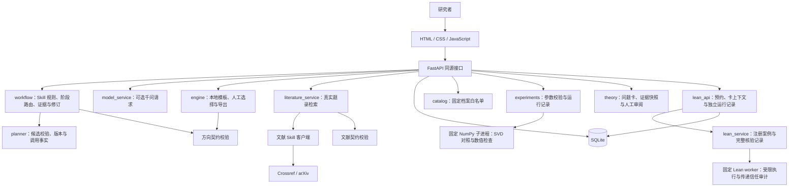

# 研证 · Yanzheng Research Workbench


**从初始想法走向有依据、能验证、可追溯的首轮研究。**

研证面向数理与 AI 研究起步，帮助研究者梳理问题与资源、查询文献、记录阅读依据、比较与修订候选课题，并形成首轮计划。工作台内可切换数值实验与理论论证：低秩场景运行固定随机 SVD，对理论问题保存命题与假设、精确笔记依据、待确认修订和证明缺口。

当前应用版本为 **0.5.0**，仓库同步日期为 **2026-10-25**。主程序位于 `webapp/`：FastAPI 同源服务、无构建前端、SQLite、百炼千问适配器、固定数值实验进程与可选的固定短引理 Lean 核验后端。它是本地单人工作台，尚未按多用户公网服务设计。

**最新本地源码（2026-10-23）**：新增五步研究导航、DOI/arXiv 精确导入、有限行动计划、项目搜索和工作空间备份恢复；改善首页、阅读与失败重试，启动器可提示旧进程。最新离线回归和真实 Chrome 验收见 [本地产品试用交付](docs/产品试用交付-2026-10-23.md)。魔搭演示入口未调整，正式研究库与运行服务未操作。

**原文与证据联动（同日新增）**：在题录下导入文字版 PDF、UTF-8 TXT/MD；选取原句并确认笔记后，候选判断可跳回对应页高亮，笔记可查看关联判断。备份保留分页文字和摘录定位，原件单独保存在本机数据库。最新操作与验收见 [交付说明](docs/原文与证据联动-2026-10-23.md)。

**两份真实公开案例**：A 形成一周 CPU 随机 SVD 复现计划，B 停止仅凭谱残差验收 PCA 的原目标并收窄。固定版本论文、精确原文定位、9次真实千问请求与响应、作者确认和助手代录记录均已随附；正式90组实验尚未执行，已完成6组冒烟。可查看 [案例说明](output/public-cases/20261023/README.md)、[三分钟1080p字幕演示](output/public-cases/20261023/研证-两份真实公开案例-三分钟.mp4) 和 [完整证据包](output/public-cases/20261023/研证-真实案例与演示.zip)。比赛封面、宣传素材和提交用 Skill 包保存在相应 `output/competition-*` 目录。GitHub 同步不触发魔搭部署。

**同步前验证（2026-10-25）**：前端与云端界面132项、云端后端36项检查通过，运行文件与依赖完整。全量 Python 运行417项，报告4处 Lean 核验失败及4项符号链接权限跳过；随后单独复核 Lean 的6项测试通过。首轮失败记录保留，Lean 间歇性问题仍未解决，不标为全量通过。具体范围见 [本次验证记录](docs/validation-github-sync-2026-10-25.json)。

**历史联合状态（证据日 2026-10-18，证据冻结于 22:31）**：该日总验收是 [2216 联合验收](docs/STATUS-2026-10-18.md)，其引用的有效全量回归证据记录 263 项 Python 与 83 项前端零失败/零错误/零跳过、9 个真实 Lean 案例预期状态一致（历史间歇超时仍未解决，不能据此宣称 Lean 可靠）。该轮接受 B 的有限浏览器能力与 C 的案例数据交付；A 已确认目标范围观测能力不足并交回实测权；B 四份实际 Chrome 下载完成，DS 已复核字节；C 的 18 论断/19 材料/四义务保持 `open`、`not_formally_verified`，独立数学审阅与研究者决定 pending。完整正式版与 8097 正式启动仍待联合验收，不能把本页当作最终通过结论。8104 是本机临时 QA 预览，不是正式服务；其模型/Lean/数值执行/下载由外围 QA 包装禁用。

## 理论论证：命题、证据与修订审阅

在“实验工作台”切换“理论论证”，保存标题、定义域、命题、定义、假设和目标；不要求先选定一个数值课题。手动请求千问后，程序先保存修订提议，展示前后差异、证明路线、引理依赖与未闭合义务。只有用户明确接受，才更新命题版本；原选题不随之改变。

理论证据精确关联 `note_id`，并保存来源版本、定位、摘录及内容 SHA256 快照。摘要笔记只能作为背景，正文笔记可提出支持/限制关系，关系仍待数学审阅。最多发送最近十条有效笔记；页面显示发送范围，超过上下文上限时保留记录并停止请求。卡、证据或选题上下文改变后，旧提议不能接受。失败保留卡、旧提议、有界的服务端实际返回及具体错误。可展开原文、记录具体意见、导出，再检查下一轮完整消息；三类反馈均核对生成时上下文：旧卡、背景或证据变化会排除；缺可靠依据的旧记录保留原件并解释，不补造历史指纹。只有明确点击才请求模型，无自动重试。

“创建公开案例”会新增独立的逐点收敛示例，不覆盖当前研究。来源为预先核对的公开大学讲义；案例笔记和提议标为 `curated_example`，不代表用户阅读、实时检索、千问生成、新定理或形式证明。理论记录支持 Markdown/JSON 导出，普通项目 JSON 同时保留它。全部自然语言论证仍为 `not_formally_verified`；详见 [理论研究实现与验收](docs/理论论证工作流.md)。

## 可选 Lean：固定短引理与独立记录

后端开放环境检查、固定案例目录、项目核验历史、手动运行和单次 JSON 下载。请求只接受注册的 `case_id`，不接受用户或模型生成的代码、命令、路径或形式陈述。独立项目固定 Lean **4.33.1**，复用本机已有工具链；首期无需 mathlib，不下载依赖或改全局工具链。当前资源管理后端只在 Windows 上验收，其他平台报告不可用。

当前使用 `-t1` 信任固定工具链的已编译导入，新本地声明仍经 Lean 内核检查；未运行独立 `leanchecker`，也未逐次重验全部导入。目标、公理与传递信任审计，以及 Windows Job 资源限制保持不变。

程序在运行前保存项目 ID、问题卡版本和内容哈希，事务外执行，另行保存适配器完整核验对象。卡在运行期间或之后改变，记录保留并显示旧上下文；版本/哈希相同也只表示上下文未变，**不表示固定形式陈述与自然语言命题语义等价**。通过不会关闭理论义务、选择课题或把整张卡标为已证明。错误、未完成、超时、不可用都不代表命题为假。

同一进程一次运行一个核验；10 秒内同项目、案例及卡上下文的重复提交复用已保存记录，不自动重试。项目 JSON 包含运行记录和预约，重启后可读取；服务不会自动恢复中断计算。相关 API 合同、独立核验合同与历史联合验收档案属于本机 `output/` 本地档案（不随仓库交付，见文末“本地档案说明”）；当前公开状态见 [2026-10-18 状态摘要](docs/STATUS-2026-10-18.md) 与 [队友交接说明](docs/TEAM-HANDOFF.md)。API 接入不自动代表页面和运行中的服务已完成联合验收。

## 使用路径

```text
输入 idea 与约束 → 千问判断信息是否足够 → 少量澄清 / 直接返回候选
       ↓                                ↓
真实查询文献 → 确认阅读位置与摘录 → 根据证据修订候选
                                          ↓
                              研究者选择并说明理由
                                          ↓
                    导出首轮计划 / 运行固定 SVD 实验
                                          ↓
                           依据实际结果重开比较与修订
```

网站提供方向探索、文献工作台、实验工作台、案例与证据、研究项目、研究记录和项目说明。推荐与人工选择分开，查询结果与实际阅读分开，历史实验与本次新运行分开。

## 已实现的能力

| 模块 | 当前状态与边界 |
|---|---|
| Skill 科研流程 | 请求时读取两个 Skill 的实际规则，保存版本哈希；信息不足返回 1–3 个澄清问题，足够时直接给候选 |
| 研究简报与补充资料 | 保存目标、资源、时间、澄清回答及补充文本；请求失败保留输入和已有候选，允许手动重试 |
| 本地候选 | 无 Key 时可用；按明确标记的模板组织，不能当作已完成的文献查新 |
| 千问规划与修订 | 显式发起后依照简报、真实查询、已确认的阅读摘录及此前实验摘要返回统一 JSON；校验结果、保留旧版本与调用事实 |
| 网页文献检索 | Crossref / arXiv，每轮 1–5 条；DOI/arXiv 官方编号或链接精确导入；保存题录响应指纹、成功、无结果和失败，单轮独立导出 |
| 阅读证据 | 导入文字版 PDF/TXT/MD，按页阅读与搜索，选句生成未确认草稿；保存原句、解释与精确定位，候选引用跳回高亮、笔记反查关联判断；不把上传或 API 摘要自动视为已读 |
| 研究项目与导出 | SQLite 持久化、搜索筛选、历史、选择理由、项目 JSON 与决策包 Markdown；工作空间备份恢复仅新增缺失项目，保留导入来源并暂停旧行动 |
| 有限行动计划 | 每轮最多 3 次公开检索、1 次模型推进，逐项显式执行，先保存预约；结果与待审修订可检查，不自动接受选题 |
| 案例与证据 | 五个案例架构、四篇历史阅读来源、随机 SVD 历史实验及白名单 JSON 下载 |
| 方向探索 Skill | 澄清、文献对照、候选比较、验证计划与研究者选择的工作规则及校验器 |
| 文献检索 Skill | CLI 支持 Crossref / arXiv / OpenAlex、JSON/RIS 导入、标识符去重、版本与来源记录、方向来源适配 |
| 固定随机 SVD 实验 | 人工选题后运行固定算法，记录矩阵哈希、种子、精确基线、逐次结果、数值检查和限制，导出 JSON / CSV |
| 理论论证 | 问题卡、版本、精确笔记快照、修订预览与人工接受/拒绝、证明路线与缺口；不自动核定数学正确性 |
| 理论核查材料 | 以真实卡/路线/义务或案例来源为目标，追加保存不可覆盖的论断、假设、支持范围、推导与审阅；不进入模型消息，不改变数学/形式状态 |
| 证据原件访问 | 固定 35 身份公开白名单；只按本项目材料明确关联的 `artifact_id` 显式读取，返回字节 SHA256 核验与转义纯文本预览；不开放任意路径或下载端点 |
| 固定 Lean 核验 | 经审查案例、准确形式陈述、公理与传递依赖审计、独立项目记录与 JSON 下载；不自动认定与问题卡语义对应 |
| 通用实验与任意形式证明执行 | 尚未实现；不执行任意代码，不把数值检查、自然语言提纲或固定案例通过等同于整项研究已证明 |

千问曾完成真实账号接入验收；这不意味着新安装者的配置已连通。模型现在可使用程序提供的检索状态、稳定来源 ID 和用户确认的阅读摘录修订候选。题录级来源只作为检索线索；科学论断的支持仍限于实际确认过的阅读范围，须由研究者审查。

## 架构



网络请求与实验计算均在 SQLite 写事务之外执行。模型只能提议受约束的阶段、问题、候选与证据关联；人工选择、阅读确认、实际请求和执行状态由程序记录。采用确定的状态节点与既有 FastAPI / SQLite，未引入 LangGraph 依赖，也没有运行自主多智能体研究团队。

### 主要组件

| 文件 | 职责 |
|---|---|
| [`webapp/app.py`](webapp/app.py) | API、输入检查、静态页面、状态和下载 |
| [`webapp/engine.py`](webapp/engine.py) | 本地候选、澄清、选题、计划与事实驱动导出 |
| [`webapp/planner.py`](webapp/planner.py) | 模型候选合同、旧版本、输入版本与并发保护 |
| [`webapp/workflow.py`](webapp/workflow.py) | 运行时读取 Skill、澄清路由、检索来源适配、阅读证据与候选修订 |
| [`webapp/model_service.py`](webapp/model_service.py) | 本机模型配置、官方端点约束、HTTP、用量与脱敏错误 |
| [`webapp/literature_service.py`](webapp/literature_service.py) | 文献客户端适配、有限查询和应用级 arXiv 间隔 |
| [`webapp/storage.py`](webapp/storage.py) | SQLite 持久化与原子修改 |
| [`webapp/catalog.py`](webapp/catalog.py) | 历史资料与固定下载清单 |
| [`webapp/experiments.py`](webapp/experiments.py) | 固定实验的可用性、参数、独立子进程、失败保存和 CSV |
| [`webapp/experiment_worker.py`](webapp/experiment_worker.py) | 三类合成矩阵、精确 / 随机 SVD、实际误差与计时、有限数值检查 |
| [`webapp/theory.py`](webapp/theory.py) | 自然语言问题卡、证据快照、提议版本、人工接受/拒绝与证明义务 |
| [`webapp/lean_api.py`](webapp/lean_api.py) | Lean 持久预约、并发与短窗口去重、卡上下文关联、独立运行记录 |
| [`webapp/lean_service.py`](webapp/lean_service.py)、[`lean_worker.py`](webapp/lean_worker.py) | 固定案例执行、工具链/源码锁、公理和额外信任检查、资源限制与真实结果 |
| [`webapp/static/`](webapp/static/) | 原生前端、内容转义和预设科研伙伴交互 |

### 数据与证据合同

- `research_direction_map` v1：输入、背景、问题、来源、候选、推荐、用户选择与下一步。
- `research_literature_search` v1：实际查询、结果、失败、来源、版本、阅读等级和证据位置。
- `research_experiment_run` v1：启动时选题快照与哈希、参数、独立执行事实、逐次结果与限制。
- `research_lean_verification` v1.0：固定案例的准确形式陈述、源码/工具链/依赖、公理审计、诊断与真实状态；项目在其外保存卡上下文关联，保留原记录。
- 项目记录：方向地图、检索轮次、用户确认的阅读摘录（可带用户声明的原文版本/哈希快照）、待处理输入、动作历史、候选版本、模型调用与实际 Token 用量。

来源等级为 `unverified → metadata_checked → abstract_checked → fulltext_checked`。接口返回摘要或 PDF 链接不会自动升级阅读等级；JSON 校验通过也不能证明科学结论正确。`fulltext_checked` 表示读过相关正文，须保留版本和具体位置，不表示通读全文。阅读笔记可选登记用户声明的原文版本、文件 SHA256（64 位小写十六进制）与哈希范围；三项须同时提供，且只是用户声明——程序不读取/认证原文，不证明内容真实性、版本正确性或科学结论。

原始文献来源 ID 仅在每轮内唯一。科研流程将 `run_id + source_id` 组成跨轮稳定引用，保留来源来路与阅读位置；用户阅读确认是单独的追加记录，不覆盖原始题录。早期 Skill 已有的阅读材料仍属于历史档案。

阅读记录由用户确认，程序不会核定论断是否得到正文支持。方向候选的 `supports`/`limits` 现在必须绑定同一轮次、同一来源、已确认且有定位的 `note_id`，并保存笔记快照与两种内容哈希；题录/背景仍只作线索。`/advance` 的模型结果先保存为待确认预览，用户显式接受后才应用并归档旧地图，可拒绝或放弃；旧 `/generate` 接口仍直接应用，只使用研究简报。阅读笔记还可保存用户声明的原文版本/文件哈希三元组，方向证据快照会带出该声明；这是用户声明而非独立认证，程序仍未读取/认证原文，也未形成经程序核验的论文版本或全文内容指纹。

## 快速开始

完整应用需要 **Python 3.12+**（固定的 NumPy 2.5.4 要求）；网站无需 GPU 或 Node 构建环境。

```shell
git clone https://github.com/mingxuanyan07-lgtm/yanzheng-research-workbench.git
cd yanzheng-research-workbench
```

### Windows / PowerShell

```powershell
cd webapp
.\Setup-Workbench.ps1
.\Start-Workbench.ps1
```

也可在已准备环境后双击根目录 `启动研证网站.cmd`。若系统限制脚本执行，可按下面的标准 Python 方式准备和启动，无需修改系统执行策略。

### 标准 Python 方式

```shell
cd webapp
python -m venv .venv
```

Windows 激活：`.\.venv\Scripts\Activate.ps1`；macOS/Linux 激活：`source .venv/bin/activate`。也可直接使用虚拟环境内 Python 的完整路径。

```shell
python -m pip install -r requirements.txt
python -m uvicorn app:app --host 127.0.0.1 --port 8097
```

浏览器访问 <http://127.0.0.1:8097/>；API 文档位于 <http://127.0.0.1:8097/api/docs>。按 Ctrl+C 停止。首次运行自动创建本机 `webapp/data/research.db`；仓库不携带任何人的真实项目数据库。

### 可选配置 Qwen

默认本地模板模式不需要模型 Key。Windows 在 `webapp/` 运行：

```powershell
.\Configure-Qwen.ps1
```

脚本通过隐藏输入保存本机 Key 与控制台的兼容 Base URL。其他系统可参考 [`.env.example`](webapp/.env.example) 在本机配置；接入地址、Key 和地域必须匹配，不要照抄文档占位符。配置文件不进入版本库。

刷新网页状态后，明确选择 Skill 科研流程并提交，或在已有项目点击千问操作，才会发起模型请求。模型可决定先澄清或直接给候选；补充回答、资料或要求修订同样会发起一次调用。默认 `qwen-plus`，120 秒超时、最多 3500 输出 Token，一次操作一次请求，不自动重试、不自动执行建议检索。用量来自接口，不推算货币费用。配置存在、最近调用成功、本项目实际使用模型分别记录。

## 独立使用 Skill

两个目录均有 `SKILL.md`、界面元数据及所需参考/脚本，可以在支持 Skill 的工具中使用，也可直接运行文献客户端。

```text
使用 $research-direction-guide，结合我的目标与资源，整理可验证的候选课题。
使用 $literature-search，检索相关方法与局限，说明实际阅读范围并保存证据记录。
```

在仓库根目录运行，无额外 Python 依赖：

```shell
python skills/literature-search/scripts/search_literature.py --query "randomized low rank approximation" --providers crossref,arxiv --limit 5 --output tmp/literature.json
python skills/literature-search/scripts/validate_literature_record.py tmp/literature.json
```

OpenAlex 和 RIS/JSON 导入目前属于 Skill/CLI 能力，网页尚未提供相应按钮。学校订阅访问不等于公开产品的数据库 API 权限；本仓库不代理复旦账号或订阅全文。详细来源与机构资源边界见 [providers.md](skills/literature-search/references/providers.md)。

## 测试与验证

在仓库根目录、已安装网站依赖的 Python 环境中运行：

```shell
python -B scripts/run_tests.py
python -B scripts/run_tests.py --suite web
python -B scripts/run_tests.py --suite skills
```

入口在导入应用前设置临时数据库，避免默认 `Store` 初始化触碰本机研究库。测试使用模拟模型/网络，不调用真实千问，也不要求提供 Key；固定实验测试会实际执行小规模 NumPy 数值计算。Lean 专项在可选工具链可用时编译固定案例，缺少工具链时真实部分会跳过；本机专项交付要求禁止跳过。早期 v0.4 发布快照见 [验证报告](docs/validation-2026-10-16.json)；最新公开状态见 [2026-10-18 状态摘要](docs/STATUS-2026-10-18.md)。历史联合验收与专项交付档案保留在本机 `output/`，不随仓库交付。GitHub Actions 的实际运行状态和跳过范围应分别查看。

数学质量验收另外保存：历史 v1.4 真实复验（本机 `output/` 档案，不随仓库交付）共3次真实请求、23512 Token、无重试；A/B结构拒绝，C结构通过但具体Bernstein上界有反例，三份原样输出均整体拒绝。人工整理版本为 curated_example，不是模型纠错成功。此次网页集成仅历史回放，不提供新的效果改善证据，仍待真实验收和独立数学审阅。前一轮14422 Token见旧报告，不能替代最新结论。

历史验证与当前测试分开：文献客户端曾真实查询三个公开接口，每个返回两条；独立试跑保留四篇阅读交接，其中三篇读过相关正文、一篇读过摘要。Qwen 曾生成并保存三条候选、保留旧方向版本，记录 3035 Token。真实模型调用通过不等于候选的科学判断已经核实。个人项目导出和本机调用截图不纳入此仓库。

## 历史实验与仓库范围

网站运行所需的五份归档 JSON 保留在原路径，不能只复制 `webapp/`：

```text
output/math-ai-workbench/experiment-data.json
output/math-ai-workbench/research-direction-map.json
output/literature-search-skill/cases/forward-trial/literature-search.json
output/literature-search-skill/cases/forward-trial/direction-handoff.json
output/project-review/cases.json
```

随机 SVD 档案包含 3 个固定 120×80 合成矩阵、目标秩 8、27 组配置、540 次随机运行和 60 次基线运行。20 个采样种子不是 20 个独立数据集；这些小规模历史观察不构成一般算法优势、创新或科研提效比例的证明。环境中的本机绝对运行库路径经过脱敏，数值、种子与矩阵哈希保留。

[`generate_experiments.py`](output/math-ai-workbench/generate_experiments.py) 供历史实验阅读和复现参考；历史环境为 Python 3.12 / NumPy 2.3.5。0.4.0 网站的固定执行器使用依赖中固定的 NumPy 2.5.4，结果保存在项目的独立运行记录中，不覆盖历史 JSON。历史脚本会重建同目录数据，应复制到独立目录后运行，以保留原始档案。

早期单文件 HTML、旧 ZIP、个人研究数据、模型凭证、虚拟环境和临时 QA 产物保留在本机，已通过根 `.gitignore` 排除。仓库保存当前可运行源码及必要资料，不把旧快照误标为本轮新执行结果。

**本地档案说明**：仓库随附运行必需的五份历史 JSON、`generate_experiments.py`、`webapp/evidence_registry_manifest.json` 登记引用的 35 份公开原件，以及本次明确列入 `.gitignore` 白名单的公开案例和比赛交付素材。公开案例的独立数据库只包含这两份演示项目及公开论文，包含其完整快照；它不包含正式研究库。其余 `output/` 历史验收与专项档案、B 四份实际下载副本、A/C 本轮冻结包都保留在本机，不随仓库交付。未列入白名单的 `output/` 路径均按“本机本地档案”理解。密钥、平台凭据截图、个人研究数据库、虚拟环境和临时运行文件不上传。

## 当前实验范围与后续工作

固定实验默认使用 3 个 120×80 合成矩阵、目标秩 8，`p=[4,8,16]`、`q=[0,1]`，每配置 3 个采样种子：共 18 个跨矩阵配置组、54 次随机运行和 9 次精确基线计时。每类矩阵只有一个数据集；重复不是独立数据集。最多 135 次随机运行，进程限时 20 秒，参数和输出均有上限。

1 MiB 输出检查在子进程结束后进行，当前没有硬内存限额、持久任务或取消恢复机制。

只启动固定本地脚本，清除子进程中的模型凭据，不接受任意代码、命令、路径或 URL。这些措施约束固定功能的运行边界，**不构成通用代码执行的硬沙箱**。后续可增加独立矩阵种子、同预算比较和更多经审查的固定执行器；其他领域目前保留计划能力。多用户公开服务还需身份、项目权限、调用预算和任务隔离，产品决策见 [项目复盘](docs/项目复盘与产品优化.md)。

后续重点是**研究闭环的语义验收与可复现评估**。v0.5 理论分支已经实现研究组织和人工审阅，固定 Lean 后端也已接入，但不代表自然语言数学正确性或科研收益已获验证；应先完成本轮联合验收，再处理已暴露的模型条件遗漏、错误否定与跨字段矛盾，并由研究者确认自然语言和准确形式陈述的对应关系。数值侧仍需独立矩阵种子、可比计算预算和独立结果检查。详细完成条件见 [路线图](docs/ROADMAP.md)。

## 文档与素材

- [网站操作与模型配置](webapp/README.md)
- [技术架构与 API](docs/研证技术架构.md)
- [项目复盘与产品定位](docs/项目复盘与产品优化.md)
- [下一阶段路线图与验收条件](docs/ROADMAP.md)
- [早期 v0.4 发布验证记录](docs/validation-2026-10-16.json)
- [2026-10-18 当前状态摘要（证据日）](docs/STATUS-2026-10-18.md)
- [队友交接：克隆、启动、样例与录制顺序](docs/TEAM-HANDOFF.md)
- 历史验收档案（数学质量复验、固定 Lean 独立验收、各专项轮次）保留在本机 `output/`，不随仓库交付；新增公开案例、演示与比赛素材按上文白名单随附。
- [素材来源与 Lucide 许可证说明](webapp/ASSETS.md)

科研伙伴“小研”为项目生成素材；其网页反馈目前是预设交互，不是独立模型代理。Lucide 素材保留上游许可证。仓库暂未指定项目代码的开源许可证；论文、题录、第三方代码和素材的使用仍遵循各自条款。

## 理论核查材料与原件访问（2026-10-18）

理论工作台支持以真实卡/路线/义务或本项目明确登记的案例来源为目标，追加保存不可覆盖的论断、使用假设、支持范围、推导和来源定位，并可追加明确范围的助手核查或人工意见。材料和旧审阅不覆盖；卡、笔记或研究背景变化时显示旧关联。保存、刷新、重启和单条/整份 JSON、Markdown 导出共用项目持久化；核查材料不进入模型消息，下一轮预览明确排除。人工意见只记录外部声明，不认证身份或数学正确性，义务保持 `open`、形式状态保持 `not_formally_verified`。

原件访问使用固定 35 身份公开白名单（`webapp/evidence_registry_manifest.json`）：只有与项目材料明确关联的 `artifact_id` 才能显式读取，返回实际字节 SHA256、声明比对与转义纯文本预览，不开放任意路径、URL 或下载端点；旧 `unknown/not_connected` 声明保留，新读取事实单独追加。字节一致不认证来源真实性、内容正确、历史已读或数学成立。注册清单记录本机绝对根路径；在非 Windows 或路径不可用的环境中会显示 `fixed_registry_unavailable`，不修改受保护清单字节。

历史录制与交接步骤见 [队友交接说明](docs/TEAM-HANDOFF.md)；2026-10-23 新增的三分钟真实案例演示及操作记录已随上述公开案例交付。B 的四份历史浏览器下载属于 QA 证据，副本不随仓库交付；8104 是临时 QA 预览，不是正式服务。工程测试、字节核对和固定 Lean 案例通过都不等于自然语言命题或数学结论已获认证。
