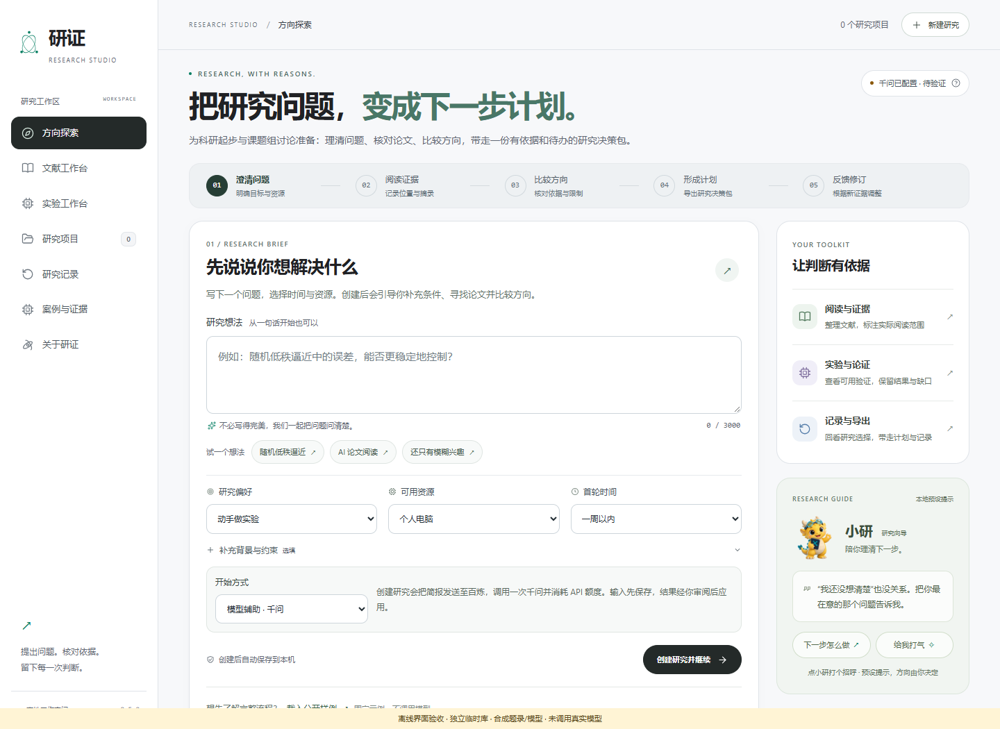
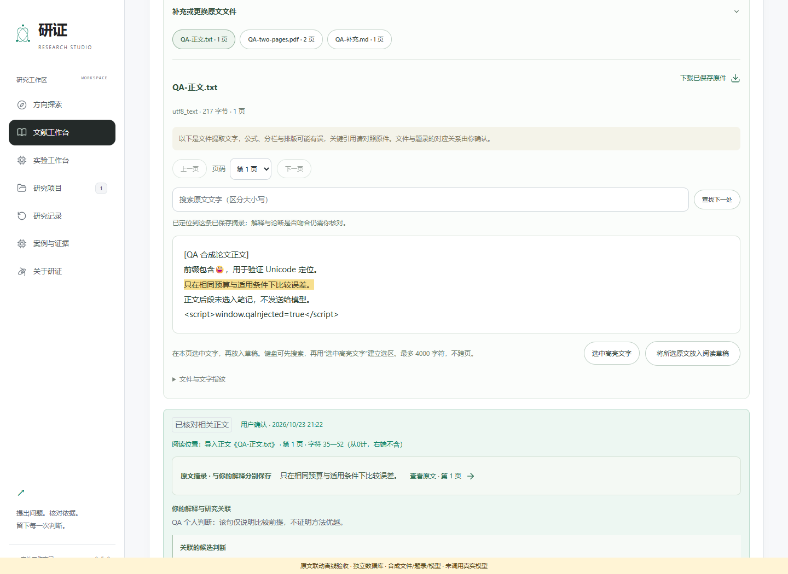
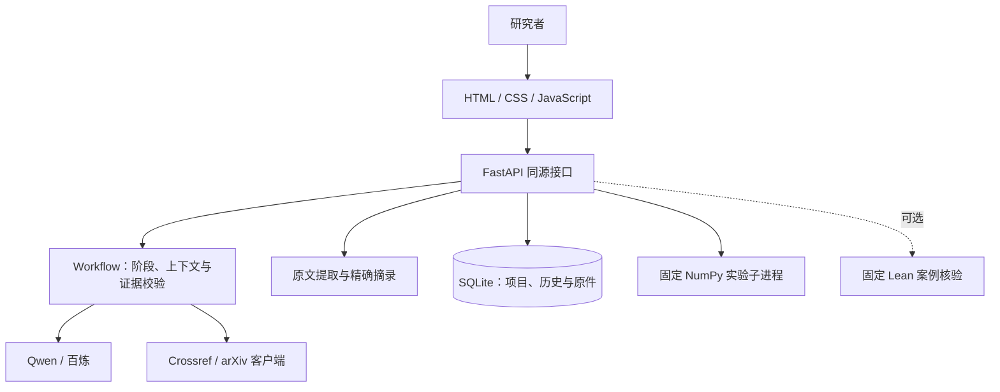

# 研证 · Yanzheng Research Workbench

**从一个研究想法，到有出处、可审阅、能验证的首轮研究计划。**

An evidence-linked AI research workbench built with FastAPI, SQLite, vanilla JavaScript and Qwen.

[](https://github.com/mingxuanyan07-lgtm/yanzheng-research-workbench/actions/workflows/checks.yml)

[三分钟演示](output/public-cases/20261023/研证-两份真实公开案例-三分钟.mp4) · [真实案例与证据](output/public-cases/20261023/README.md) · [魔搭体验入口](https://modelscope.cn/studios/zxyymx071117/yanzheng-research-demo?mode=full) · [本地运行](#本地运行) · [项目与简历说明](docs/PORTFOLIO.md)



> 界面截图来自隔离的合成验收环境，用于展示产品交互；真实论文案例、实际模型调用和人工决定另有记录。应用当前版本为 0.5.0，主要验证环境为 Windows。

## 项目解决什么问题

科研起步时，想法、文献、模型建议和验证记录通常分散在不同工具中，难以回答“这个判断依据哪段原文”“为什么接受这个方向”“证据改变后是否需要重新审阅”。

研证将这些动作放进同一个工作流：**澄清问题 → 阅读证据 → 比较方向 → 人工选择 → 形成计划 → 验证与修订**。重点是让判断可回溯，并把模型建议留在研究者可审阅的边界内。

## 核心功能与工程设计

| 功能 | 已实现的设计 |
| --- | --- |
| 研究规划与模型修订 | 运行时加载 Skill 规则；输出经过结构、来源及笔记关联校验；修订先预览，明确接受后才应用 |
| 文献检索与精确导入 | 接入 Crossref / arXiv，支持 DOI、arXiv 编号与版本导入，保存取得时间、响应指纹和实际失败记录 |
| 原文与引用联动 | 导入有文字层的 PDF、TXT、MD，按页提取与搜索；摘录保存 Unicode 字符范围及文件/页 SHA256；点击引用回到原文高亮 |
| 证据快照与过期保护 | 模型只能引用实际提供的笔记；问题、来源或笔记变化后，旧提议不能直接接受；历史版本和拒绝理由保留 |
| 数据持久化与恢复 | SQLite 事务保存项目与原件；网络调用和计算在写事务外执行；备份经完整性校验后原子恢复，同 ID 项目不覆盖 |
| 可复核的验证记录 | 固定 NumPy 随机 SVD 实验记录参数、种子、矩阵指纹与结果；可选 Lean 后端只接受登记的固定案例 |

<details>
<summary>查看原文摘录、定位与阅读笔记界面</summary>



合成文档用于验证文本保持为数据、Unicode 定位和引用回跳，不是科研结论或真实用户效果证明。

</details>

## 架构与技术栈



后端采用 **Python / FastAPI / SQLite / HTTPX / pypdf / NumPy**；前端使用原生 JavaScript，无 Node 构建依赖。工作流由明确的阶段和校验规则组织，模型没有任意执行代码或自动接受选题的权限。

## 两份真实公开案例

| 案例 | 决策与可核查材料 |
| --- | --- |
| A：形成可执行计划 | 基于 Halko 等公开论文，形成一周 CPU 随机 SVD 误差—代价复现协议，明确数据、基线、指标与停止标准。[执行计划](output/public-cases/20261023/A/EXECUTION-PLAN.md) |
| B：停止原推断并收窄 | 基于 Musco 与 Musco 的指标讨论，停止“仅凭谱范数残差验收 PCA”的目标，收窄为补充分量方差与适用条件；不强行接受有误的替代模型草案。[收窄决定](output/public-cases/20261023/B/NARROWING-DECISION.md) |

案例保留固定版本论文、精确原文位置、**9 次真实 Qwen 请求与响应**、作者确认和助手代录记录。A 的脚本已运行 **6 组冒烟检查**；正式 **90 组实验尚未执行**。这些案例展示工作流，不用于宣称新算法、普遍提效比例或已完成的正式科研实验。

- [180 秒 / 1080p 字幕演示，无配音](output/public-cases/20261023/研证-两份真实公开案例-三分钟.mp4)
- [完整案例与证据包](output/public-cases/20261023/研证-真实案例与演示.zip)
- [可直接运行的实验脚本](scripts/public_case_experiment.py)

## 本地运行

需要 **Python 3.12+**。以下为 PowerShell 命令，使用独立演示库；默认不调用付费模型。

```powershell
git clone https://github.com/mingxuanyan07-lgtm/yanzheng-research-workbench.git
cd yanzheng-research-workbench
python -m venv webapp/.venv
& .\webapp\.venv\Scripts\python.exe -m pip install -r webapp/requirements.txt

$env:YANZHENG_MODEL_PROVIDER = "demo"
$env:YANZHENG_DB_PATH = Join-Path $env:TEMP "yanzheng-demo-$(Get-Random).db"
& .\webapp\.venv\Scripts\python.exe -X utf8 -m uvicorn app:app --app-dir webapp --host 127.0.0.1 --port 8097
```

打开 <http://127.0.0.1:8097/>，结束时按 Ctrl+C。演示模式中的候选是明确标记的本地模板，不冒充模型生成。启用 Qwen 的本机配置方式见 [运行与模型配置说明](webapp/README.md)。模型请求只在明确操作后发起，可能消耗提供方额度。

请克隆完整仓库：`skills/`、`lean/` 及 `output/` 中登记的运行档案属于应用依赖。不要将个人 `.env`、密钥或研究库放入 Git。公开案例数据库只包含两份演示项目和公开论文。

## 检查与已知边界

```powershell
& .\webapp\.venv\Scripts\python.exe -X utf8 -B scripts/run_tests.py --suite all
node --test webapp/tests/frontend/*.cjs deploy/modelscope/test_cloud_demo.cjs
& .\webapp\.venv\Scripts\python.exe -X utf8 -B scripts/check_workbench.py --json
```

Node 仅用于前端测试。CI 在 Windows 上执行离线检查，不发送真实模型请求；缺少固定 Lean 工具链时，其可选集成测试按现有规则跳过。[本次整理验证](docs/validation-public-showcase-2026-11-05.json) 保留了本机全量测试中的5处 Lean 失败；历史记录见 [同步验证](docs/validation-github-sync-2026-10-25.json)。

- 当前是本地单人工作台；公网多用户生产服务所需的账户、项目权限和运营保障尚未完成。
- 原文阅读器展示提取文字；扫描 PDF、OCR 与公式排版还原未实现。关键公式应对照原 PDF。
- 模型建议及自然语言论证仍需人工核对。固定 Lean 案例通过，不代表自然语言问题已被证明；其间歇超时问题尚未解决。
- 暂未进行独立用户效果研究，不提供未经测量的效率提升或准确率承诺。

## 代码导航与文档

| 位置 | 内容 |
| --- | --- |
| [`webapp/workflow.py`](webapp/workflow.py) | Skill、阶段路由、来源和笔记关联、待审提议 |
| [`webapp/literature_service.py`](webapp/literature_service.py) | 检索适配、原文导入、字符定位与指纹校验 |
| [`webapp/storage.py`](webapp/storage.py) | SQLite 事务、原件保存、备份与恢复 |
| [`webapp/static/`](webapp/static/) | 无构建前端、阅读器与交互 |
| [`skills/`](skills/) | 科研方向探索、文献检索规则与输出契约 |
| [`deploy/modelscope/`](deploy/modelscope/) | 独立云端演示的部署源码 |
| [`tests/`](tests/) / [`webapp/tests/`](webapp/tests/) | Skill、API、前端和数据边界测试 |

[技术架构](docs/研证技术架构.md) · [原文与证据联动](docs/原文与证据联动-2026-10-23.md) · [路线图](docs/ROADMAP.md) · [开发与历史验收记录](docs/DEVELOPMENT-HISTORY.md)

本项目使用 AI 辅助开发，重要能力与限制以代码及验收记录为准。项目源码尚未指定开源许可证；第三方论文、图标与素材保留各自权利，[素材出处](webapp/ASSETS.md) 单独记录。
