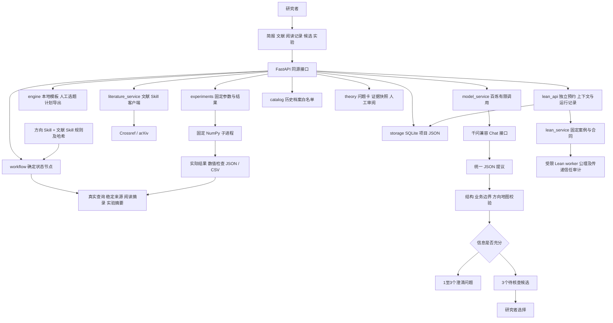

# 研证技术架构

> 本地档案说明：本文中的 `output/…` 链接均指本机本地历史档案，不随 GitHub 仓库交付；当前公开状态见 [2026-10-18 状态摘要](STATUS-2026-10-18.md)。

复核日期：2026-10-16（Asia/Shanghai）。当前应用版本：**0.5.0，本地单人研究工作台**。

本版新增 `theory.py` 与 `theory_examples.py`：在同一工作台切换数值/理论路径，保存问题卡、精确笔记快照、待确认修订、引理依赖与缺口；新增字段以缺省兼容旧项目。理论提议使用与方向流程相同的项目模型操作锁，实际调用在写事务外进行。接受时检查卡版本与上下文指纹，不更改用户已选课题。案例资料与用户阅读分别标记。另由 `lean_api.py` 接入已验收的固定案例 Lean 后端，独立保存上下文与核验记录，不改写自然语言理论状态。新增接口与完整状态边界见 [理论论证工作流](理论论证工作流.md)；下文原有数值和方向架构继续保留。

研证连接研究简报、澄清、文献查询、阅读记录、候选修订、人工选题与首轮验证。采用无构建前端、同源 FastAPI、百炼千问适配器、公开题录客户端与 SQLite；低秩场景增加固定 NumPy 实验进程。两个 Skill 的规则会在规划请求时读取，按统一 JSON 契约转化为实际流程，不作为两个独立的自主智能体部署。

本文描述源码实现和可验证边界，不把历史接入验收视为本轮测试结果。早期 v0.4 发布快照见 [验证记录](validation-2026-10-16.json)，本轮 [整合报告](../output/integration-backend/README.md) 单独登记完整测试、页面和运行服务状态，下一阶段见 [路线图](ROADMAP.md)。产品复盘见 [项目复盘与产品优化](项目复盘与产品优化.md)。

## 组件与阶段

模型只建议下一阶段、问题、候选和证据关联；程序保存人工选择、阅读确认、实际检索与执行事实。新建时可选择 Skill 科研流程或本地模板；旧模板项目保留兼容流程。网页“小研”仍使用预设交互和阶段提示，不是模型代理。

| 文件 | 实际职责 |
|---|---|
| [`app.py`](../webapp/app.py) | API、输入检查、同源策略、调用闸门、版本冲突保护、下载 |
| [`workflow.py`](../webapp/workflow.py) | 运行时读取 Skill、待处理输入、澄清路由、来源适配、阅读证据与候选修订 |
| [`engine.py`](../webapp/engine.py) | 模板、人工选择、动作历史、计划与事实驱动导出 |
| [`planner.py`](../webapp/planner.py) | 候选字段校验、版本和程序记录的调用事实；兼容旧生成接口 |
| [`model_service.py`](../webapp/model_service.py) | 本机百炼配置、端点约束、有限 HTTP 请求、用量与脱敏错误 |
| [`literature_service.py`](../webapp/literature_service.py) | 有限题录查询、文献契约、arXiv 应用级间隔 |
| [`experiments.py`](../webapp/experiments.py) | 选题资格、参数校验、固定子进程、独立运行记录与 CSV |
| [`experiment_worker.py`](../webapp/experiment_worker.py) | 三类合成矩阵、精确与随机 SVD、逐次误差、计时和数值检查 |
| [`theory.py`](../webapp/theory.py)、[`theory_examples.py`](../webapp/theory_examples.py) | 自然语言卡、精确笔记快照、人工审阅、依赖与缺口，以及明确标注的公开案例 |
| [`lean_api.py`](../webapp/lean_api.py) | 固定核验的短事务预约、并发与重复请求、独立持久记录及卡上下文比较 |
| [`lean_service.py`](../webapp/lean_service.py)、[`lean_worker.py`](../webapp/lean_worker.py) | 已审查案例、固定工具链、源码哈希、受限进程、公理与其他信任依赖审计 |
| [`lean/short-lemmas/`](../lean/short-lemmas/) | 固定 Lean 4.33.1 的独立 Lake 项目及审查锁，无外部包依赖 |
| [`storage.py`](../webapp/storage.py) | SQLite 原子修改、项目 JSON 保存、连接关闭 |
| [`catalog.py`](../webapp/catalog.py) | 历史文献、案例与实验档案，只允许固定清单下载 |
| [`skills/`](../skills/) | 两个 Skill 的实际规则、参考契约、检索和校验脚本 |

文献 CLI 还支持 OpenAlex 与 JSON / RIS 导入，当前网页仅开放 Crossref、arXiv。网站无需 LangGraph、向量数据库、消息队列或自主多代理框架，采用现有状态节点与事务即可表达这条有限流程。

## 输入保存、模型路由与失败恢复

`POST /api/projects` 的 `planning_mode=skill` 先创建并保存项目，再请求一次模型判断。`planning_mode=demo` 仍使用本地起步模板。Skill 流程每次推进时先保存待处理回答和补充资料，已有方向地图保持不变；成功校验后才应用新的阶段和候选。

模型顶层仅允许 `stage`、`questions`、`topics`、`recommendation`、`assumptions`、`search_queries`、`revision_note`。`clarifying` 要求 1–3 个问题、无候选、无推荐课题；`directions_ready` 要求无问题且恰好 3 个不同候选。模型不能返回 `topic_selected`，也不能写入来源、实际请求或执行状态。候选继续保持 `needs_review`、`provisional`，最终组装的地图使用现有方向校验器检查。

格式错误、超时、调用失败或并发冲突均保留当前输入与候选，记录失败，并允许研究者手动重试。已返回结果若遇项目 `updated_at` 变化，保存 `discarded_conflict`，不覆盖新内容。Skill 文件的 SHA-256、提示版本、输入哈希与调用用量用于追溯；每次操作至多一次模型请求，不自动重试。

默认 `qwen-plus`，非流式 JSON Object 输出，关闭模型联网和思考，120 秒超时、最多 3500 输出 Token。新版流程发送的内容包含研究简报、澄清回答、补充资料、程序提供的检索状态和来源、用户确认的阅读摘录及最近 3 轮实验（每轮至多 6 组摘要）；不会发送 API Key。兼容旧 `/generate` 接口仍只使用简报，不包含这些证据。补充资料是待分析数据，不能改变系统规则。结构校验与提示约束只能控制字段及部分业务边界，不能证明自然语言科学判断正确。

## 检索、阅读与证据关联

模型生成的 `search_queries` 只是建议。研究者选择查询式与提供方后，网页通过 Crossref / arXiv 发起真实题录查询：每轮一个提供方、一个查询、1–5 条结果；12 秒客户端超时，不自动重试。arXiv 采用进程内间隔和锁；多进程部署需另做统一限流。成功、未命中、失败及请求执行未知状态分别保存，不用旧结果补齐，也不能据此推断没有相关研究。

原始 `source.id` 仅在单轮唯一。`workflow.context_sources` 将 `run_id + source_id` 编码为跨轮稳定 ID，并保留原两部分，避免不同轮的 `S001` 混淆。原题录记录不被阅读确认覆盖。

`reading_notes` 由用户提交并明确确认，包含检索轮次、来源、阅读等级、内容、具体位置、服务端确认时间与 `origin=user_attested`。`abstract_checked` 或 `fulltext_checked` 表示用户确认核对过对应内容，后者不表示通读全文；应用不会自动抓取、阅读或验证全文。来源缺少必要题录信息时仍保持未核查，不因保存摘录自动补齐缺失作者或版本。

修订时只可关联程序提供的来源 ID：未核查来源仅可作为线索，题录核对仅可作为背景或线索；`supports` / `limits` 需要用户已确认的摘要或正文阅读，作用范围限于保存的摘录与位置。模型提议仍须人工审查，程序不会判定摘录是否忠实于原文。阅读记录、来源来路、候选版本与修订说明都保留，不能把题名或 API 返回摘要当作科学支持。

阅读笔记已支持方向候选的精确 `note_id` 绑定：`supports`/`limits` 必须是同轮次、同来源、用户确认且有 locator 的笔记，并保存 note/content 哈希、来源来路与 locator 快照；这仍不认证原文真实性或 claim 与摘录相符。方向模型结果先保存为待确认预览（含输入/上下文哈希、旧地图快照与 diff），用户显式接受后才应用并归档旧地图，可拒绝；旧 `/generate` 保持直接应用。论文独立版本/全文内容指纹与完整真实浏览器端到端仍待验收。

## 固定随机 SVD 实验

仅当方向地图处于 `topic_selected`、存在人工选题，且原始想法、澄清资料或所选课题涉及低秩 / SVD，才开放执行。模型推荐或其他未选候选不触发实验资格；其他领域保留查文献与计划能力。

执行器只接受 `rows`、`cols`、`rank`、`p_values`、`q_values`、`repeats`、`data_seed`。维数、秩、参数数量和重复次数有界，单次最多 135 次随机运行。默认 120×80、目标秩 8，3 类矩阵、18 个跨矩阵配置组、54 次随机运行、9 次精确基线计时；每类矩阵仅一个数据集，多个采样种子不是多个独立数据集。

矩阵为快速谱衰减、缓慢谱衰减、带噪低秩三类，固定种子并保存矩阵 SHA-256。精确基线为截断 SVD；随机算法采用两侧 QR 重正交的幂迭代。逐次保存相对 Frobenius 误差、基线误差、误差比、采样宽度、逻辑矩阵乘法访问预算 `2q+2` 和实际耗时。基线误差与奇异值尾范数一致、随机误差不显著低于最优秩 k 误差等检查用于发现实现错误；它们不是一般数学证明。

子进程以当前 `sys.executable -I -B` 运行固定脚本，不使用 shell，固定 cwd、剥离模型等凭据、请求 BLAS 单线程、限时 20 秒。1 MiB 输出检查在子进程结束后进行，当前没有硬内存限额或持久任务管理。它不接受任意代码、命令、路径或 URL；这些是固定功能的运行约束，**不构成通用代码执行硬沙箱**。

每轮独立使用 `research_experiment_run` v1，记录算法版本、参数、启动时选题快照及哈希、真实计数、数据、逐次结果、分组统计、检查、环境和限制。成功与失败均归档；超时或无效输出明确表示执行状态未知，只有固定进程确认已开始才记 `new_experiments_executed=true`。方向 Skill 地图自身的该字段不被改写，真实执行事实位于独立运行契约。

结果可下载 JSON / CSV。运行期间改变选题仍保留原课题快照并标注关联变化；后续重开候选后，可将程序记录的实验摘要交给千问修订，不把旧实验套用为新候选已验证。计时受调度和小矩阵开销影响，不同 p、q 的工作量也不同，不据此宣称同预算优势或一般提速。

## 固定 Lean 核验与独立持久化

`lean_service` 保留已经验收的独立合同，应用只接受注册 `case_id`，不接收代码、形式陈述、命令、路径、导入或资源配置。固定项目使用 `leanprover/lean4:v4.33.1` 与精确构建提交；无 mathlib 或第三方包依赖，不自动下载、不更改全局工具链。已安装 mathlib 的兼容检查是独立历史探测，不属于核验依赖。

启动器使用 `-t1` 信任固定工具链的已编译导入，新本地声明仍走 Lean 内核检查；未运行独立 `leanchecker`，不逐次重验全部导入。源码锁、目标及传递公理/信任审计、Windows Job 与输出及凭据限制保持不变。

`LeanRuns.run` 先用短 `Store.update` 事务保存 `lean_attempts`，程序快照包含项目 ID、卡版本和规范 JSON 内容 SHA256。提交后在写事务外运行适配器，再用短事务将完整核验对象包装为 `lean_runs` entry。外层 `association_status` 固定为 `context_only_not_semantically_verified`；不修改原始 `verification`、自然语言卡、义务、选题、`history` 或项目 `updated_at`，另记 `lean_runs_updated_at`。

`context_matches_current` 在列表、项目读取及导出时按当前卡版本和内容哈希重新计算。没有卡时 `card_version`、`card_sha256` 和比较结果为 `null`，项目 ID 仍保留；卡改变后比较为 `false`，真实运行仍保留。`true` 仅说明卡上下文未变，不证明该固定案例忠实表达自然语言问题。项目普通 JSON 同时保存最终记录与预约，旧项目缺少数组时按空数组读取，无需重建 SQLite 表。

本机单进程一次执行一个核验，忙碌返回 409。10 秒内同项目、同案例与同卡上下文重复提交复用已保存 entry，不自动重试。预约有 90 秒租期；重启只恢复读取，不自动继续执行。后续显式请求遇过期预约时，保留为 `interrupted_result_unknown` 后才新预约；没有完整核验对象的中断不会伪造运行结果。该机制不是多实例全局调度，也不是无限期的 exactly-once 保证。

`passed/error/incomplete/timeout/unavailable` 都保存完整实际结果并返回 HTTP 200；输入非法 422、项目或记录不存在 404、忙碌 409、适配器未返回有效对象 502、最终保存失败 503 分别处理。HTTP 成功仅代表结果已记录，必须另读核验状态。完整错误、下载及数据合同见 [Lean API 合同](../output/integration-backend/api-contract.md)。所有 Lean 接口均不调用模型。

通过须编译成功且目标定理传递公理与信任审计完成；依赖 `sorryAx` 判未完成，未认可公理和额外信任依赖阻止通过。Windows Job、资源上限、输出限额及凭据清除属于固定执行边界，缺少限制时报告不可用，没有文件系统或网络隔离，不是通用安全沙箱。资源策略及固定信任基础以 [独立核验报告](../output/lean-validation/README.md) 为准。错误、未完成、超时和不可用都不证明命题为假；固定通过不会把自然语言状态改为形式证明通过。

## 数据与接口

SQLite `projects` 表以 ID 为主键保存项目 JSON，`Store.update` 用 `BEGIN IMMEDIATE` 原子修改。模型、公开网络查询及实验计算均在写事务外执行。新增数组使用兼容缺省，旧项目仍能恢复。

| 项目字段 | 语义 |
|---|---|
| `intake_form`、`direction_map` | 原始简报与 `research_direction_map` v1 |
| `workflow` | Skill 模式、规则版本、待处理回答、补充材料、阶段和失败状态 |
| `literature_searches` | `research_literature_search` v1 独立检索轮次 |
| `reading_notes` | 用户确认阅读的追加记录 |
| `direction_versions`、`model_calls` | 旧方向版本、输入版本、请求用量与结果应用状态 |
| `experiments` | `research_experiment_run` v1 独立实验运行数组 |
| `theory` | 自然语言卡、版本、精确笔记快照、待审/归档提议与人工审阅；证明状态仍为未形式核验 |
| `lean_runs` | 外层卡上下文与动态关联状态、原始 `research_lean_verification` v1.0；不覆盖 `theory` |
| `lean_attempts`、`lean_runs_updated_at` | 持久预约、完成或中断事实、单独记账时间；重启不自动执行 |
| `history` | 操作时间与事实摘要，不等同于完整状态快照 |

| 接口 | 实际用途 |
|---|---|
| `GET /api/status` | 0.5.0 版本、配置状态及实际能力；固定 Lean 能力与自然语言形式核验能力分开报告 |
| `GET /api/projects`、`GET /api/projects/{id}` | 项目列表与恢复 |
| `POST /api/projects` | 保存简报；可选 `planning_mode=demo/skill` |
| `POST /api/projects/{id}/answers` | 回答当前问题；Skill 模式继续一次模型路由 |
| `POST /api/projects/{id}/advance` | 保存 `answers`、`material` 并推进 / 重试 Skill 流程 |
| `POST /api/projects/{id}/generate` | 兼容旧模板项目的三候选生成 |
| `POST /api/projects/{id}/select`、`POST /api/projects/{id}/reopen` | 人工选择、理由、返回比较；不自动执行实验 |
| `POST /api/projects/{id}/literature-search` | 有限真实题录查询 |
| `POST /api/projects/{id}/reading-notes` | 验证来源归属后保存用户阅读确认 |
| `GET /api/projects/{id}/literature/{search_id}/export` | 独立检索 JSON |
| `GET /api/projects/{id}/experiments` | 是否可运行、缺省参数与已保存运行 |
| `POST /api/projects/{id}/experiments` | 固定参数执行并追加结果 |
| `GET /api/projects/{id}/experiments/{run_id}/export?format=json/csv` | 独立实验 JSON / CSV |
| `GET /api/lean/status`、`GET /api/lean/cases` | 固定 Lean 环境可用性与经审查案例目录，不调用模型 |
| `GET /api/projects/{id}/lean/runs` | 独立核验历史，按当前卡重新比较上下文 |
| `POST /api/projects/{id}/lean/runs` | 仅 `{case_id}`；预约后事务外核验，保存原始结果及卡快照 |
| `GET /api/projects/{id}/lean/runs/{run_id}/export?format=json` | 单次 entry JSON 下载；项目 JSON 也保留全部运行与预约 |
| `GET /api/projects/{id}/export`、`GET /api/projects/{id}/plan` | 项目 JSON、已选课题计划 Markdown |
| `GET /api/library`、`GET /api/library/artifacts/{artifact_id}` | 历史资料与白名单下载 |

机器可读接口位于本机 `/api/openapi.json`，交互文档为 `/api/docs`。百炼凭据保存在忽略的本机 `.env`，进程环境优先；浏览器和项目导出不接收密钥。服务只接受受约束的官方 HTTPS 兼容端点，不跟随重定向，不是任意模型转发代理。配置存在、最近请求成功与某项目调用过千问是不同事实。

## 架构借鉴与未采用范围

- [LangGraph 的 workflow / routing 文档](https://docs.langchain.com/oss/python/langgraph/workflows-agents) 区分预定路径的工作流与自主决定工具路径的代理。研证采用有界状态路由；当前 FastAPI / SQLite 已能支撑这些节点，未安装 LangGraph，也没有将框架本身当作科研正确性保证。
- [STORM 的引擎源码](https://github.com/stanford-oval/storm/blob/main/knowledge_storm/storm_wiki/engine.py) 在知识整理后保存会话与原始检索结果，再交给 outline 等下游。研证借鉴中间证据先留存再修订候选，不宣称已部署 STORM 或实现其长文生成系统。
- [FunSearch 的 evaluator 源码](https://github.com/google-deepmind/funsearch/blob/main/implementation/evaluator.py) 将实际执行评分作为候选进入后续流程的依据，但公开的 `Sandbox.run` 仍是 `NotImplementedError`。研证借鉴评价先行，只运行经审查的固定 SVD 算法，没有安装自动发现系统或获得通用安全沙箱。

## 验收与后续边界

统一离线测试入口为 [`scripts/run_tests.py`](../scripts/run_tests.py)，导入应用前隔离临时数据库。模型和网络测试用模拟响应；固定实验测试会真实运行 NumPy，检验解析小矩阵、种子复现、计数、边界和失败归档。本轮数量和实际外部请求结果以验收记录为准，不从测试定义推断已通过。

0.2.0 的公开查询及界面验收、0.3.0 的真实千问接入与 3035 Token 记录属于历史材料；`output/math-ai-workbench/experiment-data.json` 仍是此前 3 个固定矩阵、540 次随机运行的档案，和当前项目的每次新实验分开。

数学质量验收的三次真实千问请求共 14422 Token，全部有整体拒绝理由，其中两次结构合格仍有数学错误；自然语言语义审阅未通过。最终理论专项 34 项、非 Lean 范围 150 项通过属于该窗口范围；其早期全仓 166 项出现 3 个 Lean 文件缺失错误，日志仍保留，不能拿后来专项成功改写旧快照。固定 Lean 独立验收另有 25 项、9 份真实记录；本轮联合测试必须在所有材料就绪后新跑，实际结果见 [网站整合报告](../output/integration-backend/README.md)。

当前监听 `127.0.0.1`，没有账户、项目权限、持久化执行队列或跨实例调用预算；Lean 持久预约只用于记录与阻止重复，不是后台任务系统。同源策略不能代替身份隔离，源码上传也不等于公网服务部署。后续优先完成联合验收、自然语言语义审查与形式陈述对应确认，并扩展独立数据种子、可比预算实验和经审查的固定执行器；不把模型审阅、有限数值检查或一个固定案例通过当作整项研究已证明。
