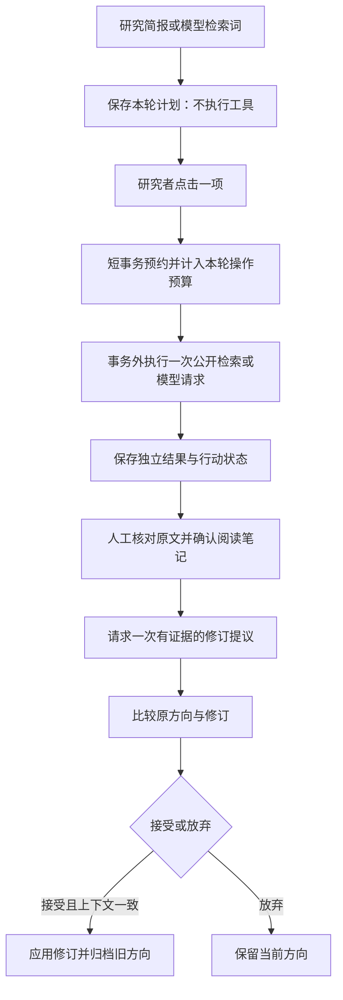

# 研证：前三项参赛优化交付

日期：2026-10-23。范围：本地研究工作台源码，服务学生研究入门与导师/课题组讨论；魔搭演示入口、部署文件及正式研究库未调整。本轮新增功能经过隔离测试，尚未发布或替换已有运行服务。

后续同日已完成产品体验、备份恢复与证据访问修复，最新全量结果见 [本地产品试用交付](产品试用交付-2026-10-23.md)。本文的 344 项及当时失败情况保留为第一轮验收记录。

## 1. 让一次研究任务有明确成果

主界面按“澄清问题 → 阅读证据 → 比较方向 → 形成计划 → 反馈修订”组织，展示当前事实、下一步操作，以及本轮交付物“可审阅的研究决策包”。入口会直接跳转对应工作区，并展开需要填写的选择理由。

阶段根据已保存数据推导：有待审提议则进入审阅；缺少有效确认笔记则提示阅读；已有笔记后提示比较；人工选择后可导出决策包。没有阅读依据也能保存计划草案，但会明确提示补证据。样例材料、别的项目来源和未确认草稿不算本人阅读。

决策包沿用 Markdown 下载，增加本轮行动、实际查询记录、题录版本与响应指纹，便于导师检查问题、依据、选择与下一步验证。

## 2. 从导师给的论文开始

文献区支持 DOI、`doi.org/...`、arXiv 编号及其摘要/PDF 官方链接；精确导入最多一条题录。Crossref 只覆盖其登记的 DOI，查不到不能推断论文不存在。arXiv 可以明确指定 `v2` 等版本，并核对返回版本。

保存内容包括标题、作者、年份、标识符、返回版本、取得时间及官方题录响应正文的 SHA256。相同规范化编号已成功导入时复用原记录。失败与未命中独立保存，用户可核对后手动再次导入。

接口摘要只能填入**未确认**阅读草稿。研究者仍需核对原文、填写实际阅读位置和笔记并勾选确认；程序不下载或认证全文。已确认笔记保留当时的题录快照，进入方向证据时继续保存该快照，避免接受修订后丢失出处。用户自行声明的原文文件哈希与题录响应哈希分开保存。

## 3. 让智能体行动可见、有限、可审阅

采用已有 FastAPI、SQLite 和模型适配器上的有限工作流，无需新增智能体框架。模型建议的检索词用于安排查询；工具结果与研究者阅读笔记用于下一轮模型提议；接受修订仍由人执行。



- 每轮硬限制：最多 3 次公开检索操作、1 次模型推进；来源不足不允许证据修订。每项行动先持久化预约，之后即使换请求 ID 或重启也不会重复执行。
- 待审提议、暂停、研究上下文改变或预算用尽会阻止后续行动。结果未知时保留状态，明确新建下一轮才可再次安排；失败不自动重试。
- 公开检索最多返回 3 条/行动；官方精确导入最大读取 2 MiB，12 秒 HTTP 超时，不跟随重定向。arXiv 精确导入和关键词检索共用进程内限频。
- 这些是本轮行动的操作上限，其他手动功能不计入此预算；它不是全账户费用上限。当前为本地单进程运行，无跨实例队列、自动后台循环或全局费用控制。

## 实现位置与接口

| 位置 | 本轮职责 |
| --- | --- |
| `webapp/static/app.js`、`index.html`、`styles.css` | 五步导航、导入与阅读草稿、行动状态、桌面/手机适配 |
| `webapp/literature_service.py` | 官方编号解析、精确请求、版本核对、响应指纹、失败事实 |
| `webapp/workflow.py` | 计划上下文、预约与预算、有效阅读判断、证据快照 |
| `webapp/app.py` | 请求校验、项目工具锁、事务外执行、结果持久化与提议复用 |
| `webapp/engine.py` | 在决策包中呈现来源与本轮行动 |
| `skills/research-direction-guide/scripts/validate_direction_map.py` | 接受修订时校验可选题录快照，保持旧记录兼容 |

新增接口（均位于 `/api/projects/{project_id}` 下）：

| 路径 | 行为 |
| --- | --- |
| `POST /literature-import` | `{reference}`；返回项目、导入状态、run_id 与重复标识 |
| `POST /research-plan` | `{provider}`；保存计划，不执行工具 |
| `POST /research-plan/pause` | `{}`；停止后续动作，不撤销已发请求 |
| `POST /research-plan/actions/{action_id}/run` | `{plan_id, request_id}`；预约并执行一项，重复不重发 |

## 验收

专项后端 12 项通过；前端 97 项通过；Skill/契约 52 项通过。覆盖精确编号与版本、失败和重复导入、题录/全文指纹分离、已读证据绑定、接受修订、暂停/过期/预算、重启后不重复、导出及页面转义。

真实 Chrome 的 12 项流程检查通过，包含实际 Markdown 下载、刷新恢复及 390 px 无横向溢出。浏览器运行使用独立临时数据库、合成题录与模型替身，未请求真实模型；不能据此宣称真实模型科研质量通过验收。

另外向 Crossref 与 arXiv 官方接口各发一次公开题录请求：`10.1137/090771806` 和 `0909.4061v2` 均返回 1 条，后者保留 `0909.4061v2`。该检查未导入应用或打开研究库。

验收产物位于本机 `output/research-journey-acceptance/1792754036336-4de954/`，包括桌面与手机截图、合成决策包、操作审计、布局检查及 `validation.json`。联网连通性结果位于 `tmp/research-upgrade-live-metadata.json`。这些临时材料不随 Git 提交。

最终全量 Python 回归运行 344 项，报告 3 个失败、3 个错误及 4 个跳过，未通过。失败和错误均在已有 `test_theory_evidence_access` 的原件读取/预览测试中；执行修改前保存的源文件已复现相同失败。4 个跳过由本机不具备真实符号链接创建权限导致。本轮首次全量及旧版复现还出现 Lean 超时，最终运行未出现 Lean 失败，间歇问题仍未解决。日志分别为 `tmp/research-upgrade-python-final.log`、`tmp/research-upgrade-python.log` 与 `tmp/research-upgrade-baseline-check.log`。这些问题仍需后续修复，当前工作台不能标为全量验收通过。

与修改前快照逐项比较，`deploy/modelscope/` 下保存的 20 个文件哈希全部一致；已有 `webapp/tests/test_backend.py` 的用户修改也保持原字节。

复现命令（仓库根目录，Python 环境同原应用）：

```powershell
webapp/.venv/Scripts/python.exe -X utf8 -B scripts/run_tests.py --suite web --pattern test_research_journey.py
webapp/.venv/Scripts/python.exe -X utf8 -B scripts/run_tests.py --suite skills
node --test webapp/tests/frontend/*.cjs
# 另需可用的 Playwright 和 Chrome；可用 PLAYWRIGHT_MODULE 指定已有模块位置
node scripts/research_journey_browser_acceptance.cjs
```

浏览器验收脚本只启动并停止它创建的动态本地端口服务，数据库在该轮输出目录内，页面与导出均标明 QA 合成数据。

## 架构参考

精确 DOI 使用 [Crossref 官方 REST 文档](https://www.crossref.org/documentation/retrieve-metadata/rest-api/)，arXiv 使用 [官方 API 手册](https://info.arxiv.org/help/api/user-manual.html) 的 `id_list` 与版本约定。有限工具反馈与人工确认的实现取舍参考 [Building effective agents](https://www.anthropic.com/research/building-effective-agents)；本项目具体预算、状态与接口由代码约束，不依赖模型自行遵守。
